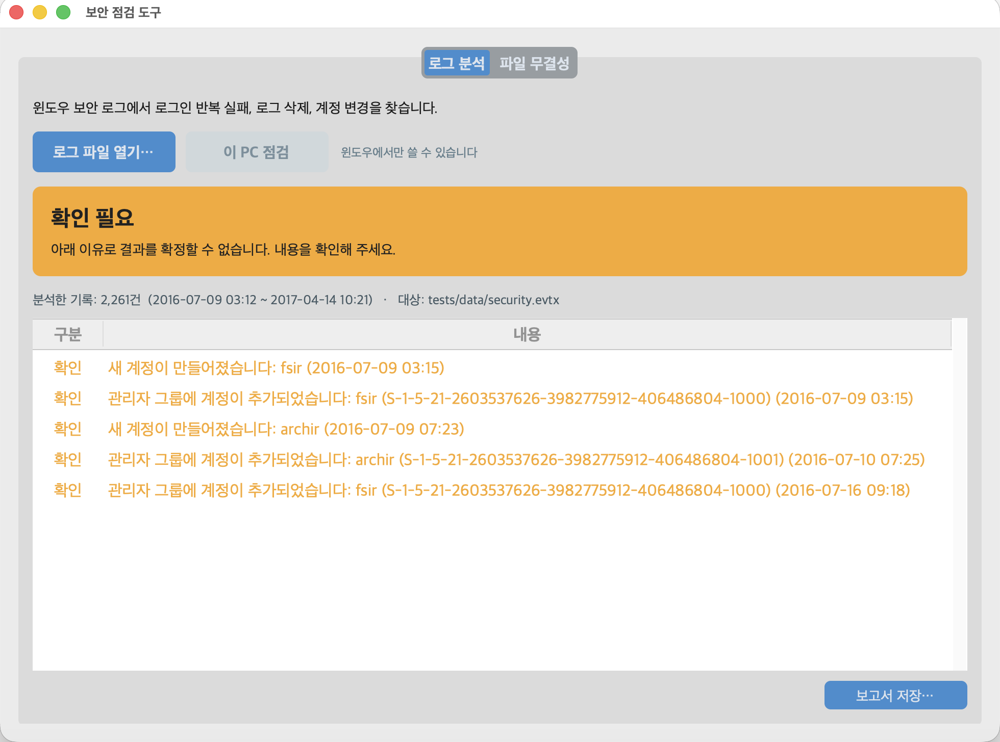
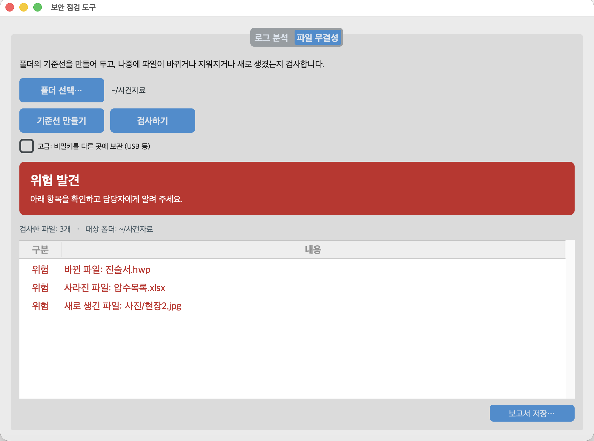

# 보안 점검 도구 (Security Check)

[](https://github.com/yoopeace/security-check-app/actions/workflows/ci.yml)

윈도우 업무용 PC에서 인터넷 없이 쓰는 보안 점검 데스크톱 앱.

---

## 개요

컴퓨터에 익숙하지 않은 직원도 버튼만 눌러 쓸 수 있도록 만든 데스크톱 앱임.
결과는 "위험 발견 / 확인 필요 / 이상 없음" 세 가지와 쉬운 문장으로만 보여 줌.

- 로그 분석: 윈도우 보안 이벤트 로그(`.evtx`)에서 로그인 반복 실패, 보안 로그 삭제, 계정 변경을 찾음
- 파일 무결성 검사: 폴더의 기준선을 만들어 두고, 나중에 파일이 바뀌거나 지워지거나 새로 생겼는지 검사함

탐지 로직은 아래 두 도구를 그대로 불러 씀 (복사하지 않고 버전 태그로 설치).

| 도구 | 앱에서 쓰는 부분 |
|------|------------------|
| [log-analyzer](https://github.com/yoopeace/log-analyzer) | 시간 창 기반 브루트포스 판정 (급속 10분 40회, 누적 24시간 8회) |
| [file-integrity-checker](https://github.com/yoopeace/file-integrity-checker) | SHA-256 지문과 HMAC 서명 기준선, 변조·삭제·추가 비교 |

---

## 화면

로그 분석 (예시 보안 로그):



파일 무결성 검사 (기준선을 만든 뒤 파일을 수정·삭제·추가한 경우):



화면은 맥에서 개발 중에 찍은 것임. 윈도우에서는 맑은 고딕으로 표시됨.

---

## 판정 기준

**로그 분석**

| 이벤트 | 뜻 | 판정 |
|--------|----|------|
| 4625 | 로그인 실패 | 같은 대상이 기준(급속 10분 40회, 누적 24시간 8회) 이상이면 위험 |
| 1102 | 보안 로그 삭제 | 위험 (흔적 삭제 의심) |
| 4740 | 계정 잠금 | 확인 필요 |
| 4720 | 새 계정 생성 | 확인 필요 |
| 4732 | 관리자 그룹(Administrators)에 계정 추가 | 확인 필요 |

- 로그인 실패는 원격 IP 가 있으면 IP별, PC 앞에서 직접 시도한 경우(IP 없음)는 계정별로 셈
- 판정은 UTC 로 하고, 화면과 보고서의 시각은 한국 시각으로 표시함
- 보안 로그가 아닌 파일, 로그인 기록이 하나도 없는 로그(감사 정책 꺼짐 의심), 읽지 못한 기록이 있는 로그는 "이상 없음"이 아니라 "확인 필요"로 표시함

**파일 무결성**

| 결과 | 판정 |
|------|------|
| 바뀐 파일, 사라진 파일, 새로 생긴 파일 | 위험 |
| 읽지 못한 파일, 기준선 없음, 기준선 서명 불일치, 비밀키 없음 | 확인 필요 |
| 기준선과 모두 같음 | 이상 없음 |

---

## 내려받기와 실행

1. [GitHub Actions](https://github.com/yoopeace/security-check-app/actions/workflows/ci.yml) 에서 최근 성공한 실행을 열고 Artifacts 의 `SecurityCheck-windows` 를 내려받음 (GitHub 로그인 필요)
2. 압축을 풀고 `SecurityCheck.exe` 실행 (설치 과정 없음, 파이썬 불필요)
3. 처음 실행할 때 "Windows의 PC 보호" 경고가 뜨면 "추가 정보" → "실행"

코드 서명 인증서가 없는 실행 파일이라 첫 실행 경고가 뜨거나 백신이 막을 수 있음.
업무용 PC 에서 실행하기 전에 소속 기관의 보안 규정과 허용 여부를 먼저 확인해야 함.

### 분석할 보안 로그 준비

이벤트 뷰어 → Windows 로그 → 보안 → 오른쪽 "모든 이벤트를 다른 이름으로 저장…" → 파일 형식 `.evtx` 로 저장.
보안 로그는 관리자 권한이 있어야 열 수 있음.

"이 PC 점검" 버튼은 관리자 권한으로 실행했을 때 지금 PC 의 보안 로그를 바로 분석함 (내부적으로 `wevtutil` 로 임시 파일을 만들고 분석 후 지움).

---

## 유의사항

- 분석하는 `.evtx` 파일과 검사하는 폴더에는 아무것도 쓰지 않음 (읽기 전용, 테스트로 확인)
- 기준선·비밀키·검사 기록은 `%LOCALAPPDATA%\SecurityCheck\integrity\` 아래 폴더별 칸에 저장함
- 이미 기준선이 있는 폴더에서 기준선을 다시 만들면 확인 창을 띄움. 변조된 뒤 기준선을 새로 만들면 변조가 정상으로 기록되기 때문임 (기본 선택은 "취소")
- 비밀키를 USB 등 다른 곳에 두려면 파일 무결성 탭의 고급 설정을 사용함
- 관리자 그룹에 추가된 계정이 고유 번호(SID)로만 기록된 경우, 같은 로그의 계정 생성 기록에서 이름을 찾아 함께 표시함
- 보고서는 UTF-8(BOM 포함) 텍스트로 저장해 메모장·한글·엑셀에서 한글이 깨지지 않음

## 알려진 한계

- 코드 서명이 없어 첫 실행 경고와 백신 오탐이 생길 수 있음
- `.evtx` 읽기는 초당 약 500건 수준임. 기본 크기 보안 로그(약 2만 건)는 40초 안팎이 걸림
- 감사 정책이 꺼진 PC 는 로그인 기록이 남지 않아 판정 근거가 없음 ("확인 필요"로 표시)
- 4732 의 구성원 이름은 같은 로그 안에 계정 생성 기록(4720)이 있을 때만 찾을 수 있음
- 파일 무결성 검사의 한계(파일 내용만 비교, 링크 대상 변경 미탐지 등)는 [file-integrity-checker](https://github.com/yoopeace/file-integrity-checker#알려진-한계) 와 같음

---

## 개발

```bash
python3 -m venv .venv
.venv/bin/pip install -r requirements-dev.txt
.venv/bin/pytest
.venv/bin/python -m seccheck
```

- 맥에서 화면을 띄우려면 tkinter 가 필요함 (Homebrew 파이썬은 `brew install python-tk@3.14`)
- 전체 테스트 90건. 화면 테스트 9건은 화면을 띄울 수 있는 환경에서만 실행됨 (우분투 CI 는 건너뜀)
- `main` 에 push 하면 GitHub Actions 가 우분투·윈도우에서 테스트하고, 윈도우에서 `SecurityCheck.exe` 를 만들어 `--smoke-test` 로 켜지는지 확인함
- 윈도우 실제 확인은 [docs/windows-checklist.md](docs/windows-checklist.md) 점검표로 진행함

| 파일 | 역할 |
|------|------|
| `seccheck/winevents.py` | 이벤트 XML 해석, `.evtx` 읽기 |
| `seccheck/log_check.py` | 로그 판정 규칙 |
| `seccheck/integrity_check.py` | 파일 무결성 판정 (file-integrity-checker 감싸기) |
| `seccheck/this_pc.py` | 관리자 권한 확인, 보안 로그 내보내기 |
| `seccheck/actions.py` | 화면 버튼이 부르는 동작 |
| `seccheck/report_text.py` | 보고서 문장 |
| `seccheck/app.py`, `seccheck/ui_common.py` | 화면 |
| `tests/data/` | 공개 예시 로그 ([출처와 라이선스](tests/data/README.md)) |

설계: [docs/superpowers/specs/2026-11-13-windows-desktop-app-design.md](docs/superpowers/specs/2026-11-13-windows-desktop-app-design.md)

---

## 기술 스택

- Python 3.12 (실행 파일 빌드), CustomTkinter, python-evtx, PyInstaller
- 테스트: pytest

## 라이선스

MIT License — [LICENSE](LICENSE) 참고

## 개발자

- GitHub: [yoopeace](https://github.com/yoopeace)
- 현직 경찰관 재직
